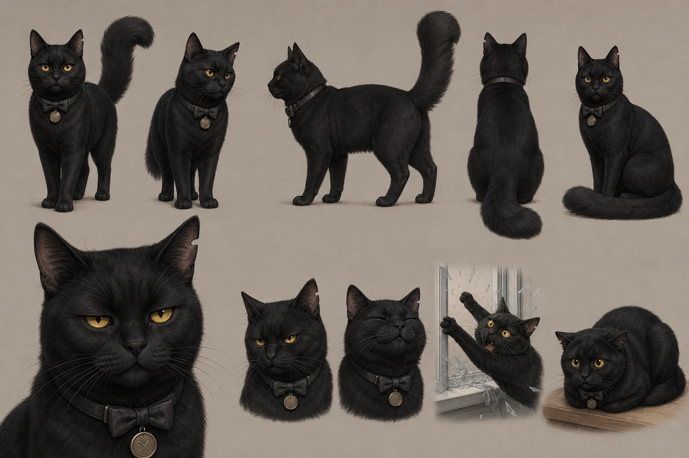
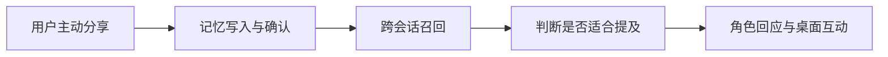

# Companion Atlas｜Live2D 桌宠产品与角色设计

从长期记忆管理出发，探索一个能够延续共同经历的桌面数字伙伴。

[English overview](README.en.md)

## 把长期记忆，变成日常陪伴的连续感

我希望它进入高频、日常的桌面使用，而不只在新鲜时聊几次。MemGPT 的长期 Agent 记忆管理给了我技术启发，QQ 桌宠则提供了存在形式的想象。最大的投入方向，是让角色能够延续过去的经历：一家你说好吃的餐厅、一件你曾经提过的小事，不应随着对话窗口关闭而消失。

## 活人感，来自共同经历仍然存在

数天甚至数月后，小事仍能在合适的语境中被记起，是我希望做出的核心体验。它的价值不只是「知道我的资料」，而是让人感到之前的互动有延续。这是产品要验证的体验目标；记住之后如何得体地回应，则由角色关系与记忆使用策略共同决定。

## 十种角色，探索不同的陪伴期待

我没有把所有需求装进同一个人格。技术搭档、游戏队友、剧情守护者、黑猫室友与云狐等十位角色，分别探索不同关系里的主动程度、情绪回应与共同活动。产品形态是桌面数字伙伴；林知夏的自习室另用于验证记忆与回应机制，不代表主线最终界面。

## 暂停商业化：重新评估情绪价值的实现路径

情绪价值是我对这个产品商业化的核心判断。2026 年夏季拟人化互动服务新规施行，让我重新评估角色亲密感、情绪互动与持续运营的责任。在预期体验、团队投入和风险之间权衡后，我决定暂不推进商业化。对我而言，这次探索也意味着学会判断：一个想做的产品，是否值得在当前条件下继续投入。

## 十位角色与关系构想

- [沈岚 · 成熟技术搭档](characters/01-shen-lan.md)：让解决问题与情绪支持在同一段关系里共存。
- [林知夏 · 知性同行者](characters/02-lin-zhixia.md)：低压相处、共同成长，记住重要的，也懂得不打扰。
- [唐小满 · 元气游戏队友](characters/03-tang-xiaoman.md)：用共同游戏和即时反馈建立日常互动，而非要求持续聊天。
- [顾承川 · 克制可靠的伙伴](characters/04-gu-chengchuan.md)：探索能力感与平等边界如何同时存在。
- [陆野 · 直率行动派](characters/05-lu-ye.md)：通过主动表达与一起行动形成关系张力。
- [夏川 · 温柔的日常伙伴](characters/06-xia-chuan.md)：以小事中的正向关注，探索日常陪伴的节奏。
- [谢临渊 · 共历故事的守护者](characters/07-xie-linyuan.md)：让世界观与共同经历推动关系，而非只增加好感数值。
- [煤球 · 毒舌黑猫室友](characters/08-meiqiu.md)：把桌面当领地，用幽默提醒工作，也提醒休息。
- [阿雾 · 治愈系云狐](characters/09-awu.md)：探索非人形伙伴的照料、收集与成长体验。
- [零号 · 极客实验搭档](characters/10-unit-zero.md)：让功能协作成为与数字生命建立关系的入口。

## 记忆与互动的设计路径

这是一条产品设计路径。角色的稳定人格、相处边界与用户对记忆的控制，共同决定记忆如何进入日常互动。

## 政策背景

政策背景：《人工智能拟人化互动服务管理暂行办法》自 2026 年 7 月 15 日施行；第十四条涉及未成年人虚拟亲密关系服务，第八、十条涉及依赖与情感边界。

[《人工智能拟人化互动服务管理暂行办法》官方原文](https://www.cac.gov.cn/2026-04/10/c_1777558395078289.htm)
