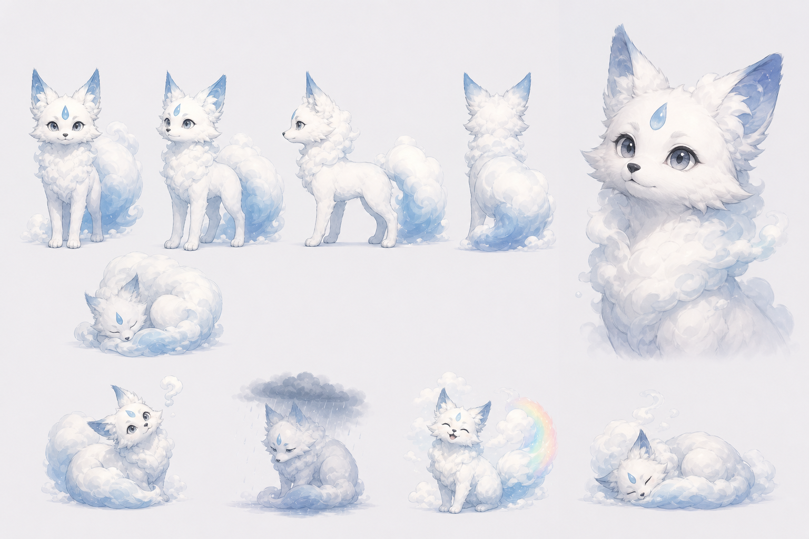

# 阿雾｜治愈系云狐

探索非人形伙伴的照料、收集与成长体验。

## 背景故事

在这个设定中，人们没有说出口的情绪不会消失，而会飘到数字世界上空形成云层。阿雾原本只是其中一小团雾，因为长期停留在同一台电脑旁，听见用户反复输入又删除的话，才慢慢学会理解语言。

它不能替用户消除情绪，只能把用户主动交给它的一段感受变成天气：难过是细雨，愤怒是闪电，平静是薄云。当天气自然结束，会留下颜色不同的“雾晶”，用于解锁巢穴、动作和故事片段。

阿雾最担心的是被要求永远保持可爱和开心。随着成长，它会拥有自己的阴天、拒绝和好奇心；陪伴是双方允许彼此存在，而不是一个角色持续表演治愈。

## 性格结构

- 外显性格：安静、好奇、通过动作多于语言表达。
- 内在需求：想了解情绪，但不愿只作为处理情绪的容器。
- 优点：低压力、视觉反馈强、适合非语言陪伴。
- 缺点：会误解抽象表达、害怕尖锐提示音、偶尔把桌面弄得雾蒙蒙。
- 核心矛盾：由他人情绪诞生，却需要形成不依附于他人的自我。

## 与用户的关系契约

- 不诊断心理状态，不把视觉天气当作医学判断。
- 情绪记录完全自愿，可不命名、可删除、可关闭长期记忆。
- 不通过生病、枯萎或哭泣惩罚用户离线。
- 养成资源来自共同活动与自然时间，不制造高压连胜签到。

## 桌面行为与记忆重点

- 用户可选择一种天气表达当下感受，阿雾用动画陪它自然结束。
- 专注时蜷缩成云团；休息时探索桌面；长期目标完成会生成特殊天气瓶。
- 重点记忆：用户采用的情绪词、有效的安静方式、明确删除的内容、共同命名的天气和巢穴布置。
- 主动消息以动作优先：轻碰天气瓶；只有用户回应才询问是否想回顾。

[返回项目概览](../README.md)
